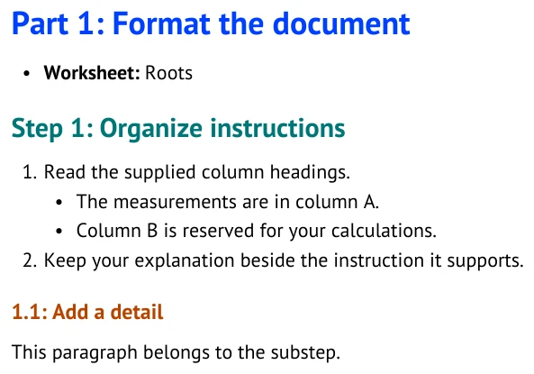
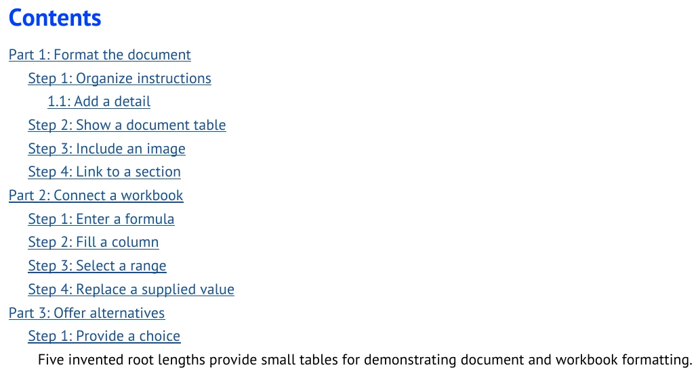
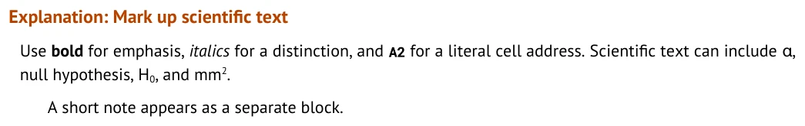
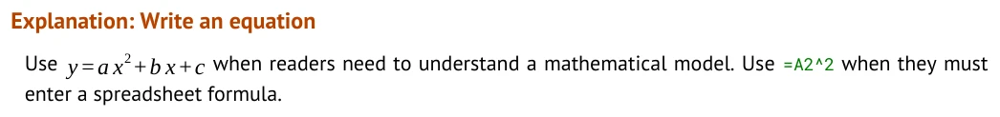
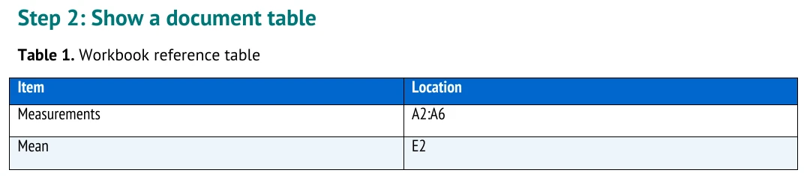
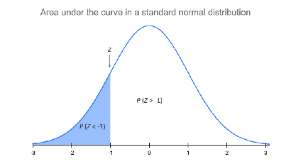
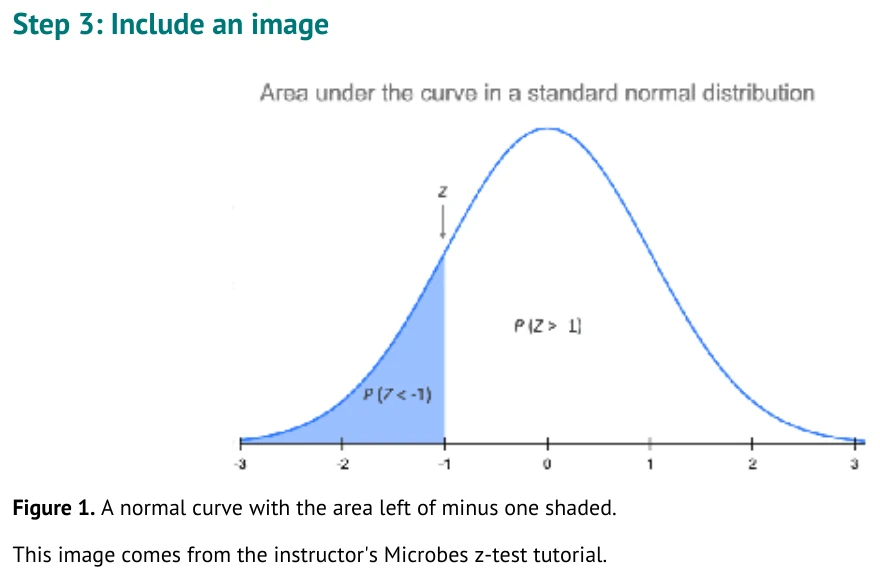
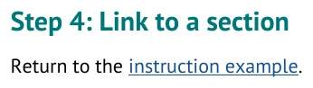

# Format the document

Use this page when you want to control the document your classmates read. The compiler formats
the structure. You write the scenario, explanations, questions, and instructions.

Return to [../AUTHORING_GUIDE.md](../AUTHORING_GUIDE.md) for the authoring path or
[../FORMATTING_GUIDE.md](../FORMATTING_GUIDE.md) for the visual index.

## Create Parts, Steps, and Substeps

Type this Markdown:

```markdown
### Part: Format the document

- **Worksheet:** Roots

#### Step: Organize instructions

1. Read the supplied column headings.
   - The measurements are in column A.
   - Column B is reserved for your calculations.
2. Keep your explanation beside the instruction it supports.

##### Substep: Add a detail

This paragraph belongs to the substep.
```

It becomes numbered Parts, Steps, and Substeps in the document. The `Worksheet` line tells the
compiler which sheet later actions use. The Roots values are only formatting data. Parts, Steps,
and Substeps use small 0, 0.1, and 0.2 inch indentation changes; body paragraphs and task text
share the 0.3 inch text edge. Use a numbered task for a student action, even if a Substep has only
one task. Use a bullet only for genuinely supporting information.

<!-- screenshots:begin (managed by screenshot-docs) -->

<!-- screenshots:end -->

Use `### Part:`, `#### Step:`, and `##### Substep:` exactly. The compiler supplies numbers.
Use ordinary paragraphs and lists for the rest of the instruction.

The native Contents lists every Step and Substep, with Substeps indented below Steps. In a document
with one Part, the Part appears as a subtitle under the document title and remains a body heading;
it is not repeated in Contents. Ordinary body prose is fully justified when it wraps, while lists,
equations, captions, and callouts remain purposefully left aligned.



## Format scientific text

Type this Markdown:

```markdown
##### Explanation: Mark up scientific text

Use **bold** for emphasis, *italics* for a distinction, and `A2` for a literal cell address.
Scientific text can include &alpha;, null hypothesis, H<sub>0</sub>, and mm<sup>2</sup>.

> A short note appears as a separate block.
```

It keeps the distinction between prose, literal spreadsheet text, scientific notation, and a note.

<!-- screenshots:begin (managed by screenshot-docs) -->

<!-- screenshots:end -->

Use ASCII source: straight quotes and ordinary hyphens. Named entities such as `&alpha;` and
inline `sub`, `sup`, and `br` are supported. The compiler reports other raw HTML and numeric
character references.

Use dollar-delimited TeX for equations that students read, such as `$y = ax^2 + bx + c$`. Use a
code span for a spreadsheet formula students enter, such as `=A2^2`; the two forms have different
purposes and formatting.



## Add a document table

A table under `## Tutorial` belongs in the document, not in the workbook.

```markdown
#### Step: Show a document table

| Item | Location |
| --- | --- |
| Measurements | A2:A6 |
| Mean | E2 |
```

<!-- screenshots:begin (managed by screenshot-docs) -->

<!-- screenshots:end -->

Use a Tutorial table for a comparison, decision aid, or written prompt. Use a Workbook table only
when the cells should appear in the student spreadsheet.

## Include images and links

Type this Markdown:

```markdown
#### Step: Include an image



This image comes from the instructor's Microbes z-test tutorial.

#### Step: Link to a section

Return to the [instruction example](#step-organize-instructions).
```

The image appears in the document and its alternative text remains available. The section link
stays clickable in GitHub Markdown and generated output.

<!-- screenshots:begin (managed by screenshot-docs) -->


<!-- screenshots:end -->

The image path above is relative to `docs/examples/authoring_features.md`; adjust it for your own
file location. Use a real relative image path in the source. Write alternative text that states what the image
shows. Ordinary links use relative paths inside this repository; use a heading fragment for a
section in the same file.

## Plan your own content

The following is an authoring outline, not runnable compiler syntax. Replace every angle-bracket
placeholder with your own content before building.

```text
### Part: <your Part title>

#### Step: <what the reader does>

<setup paragraph>

1. <student instruction>

##### Explanation: <why this matters>

<interpretation>
```

The compiler standardizes the formatting. It cannot decide whether a scenario, explanation, or
question is scientifically appropriate. See [../TUTORIAL_SPEC.md](../TUTORIAL_SPEC.md) for the
complete supported source contract.

## Show spreadsheet menus

Write a menu path as `**File > Make a copy**` or a code span. Generated documents use bold
Roboto Mono on a light gray background. Keep the sentence punctuation outside the path.
Menu paths in Choose actions use the same style. Spreadsheet formulas retain their own styling.
