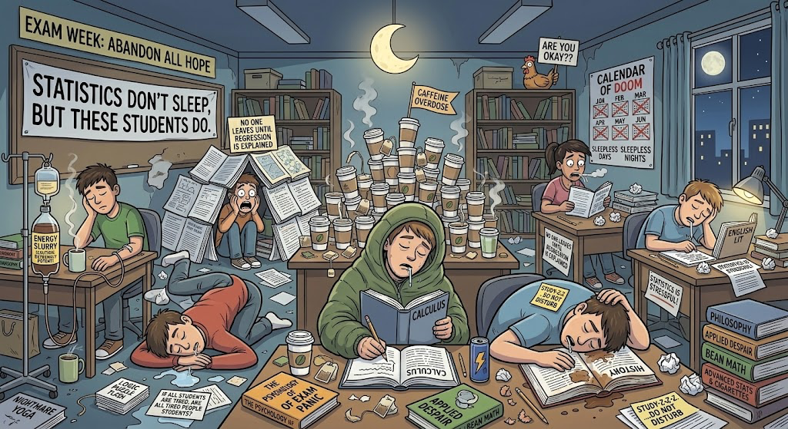
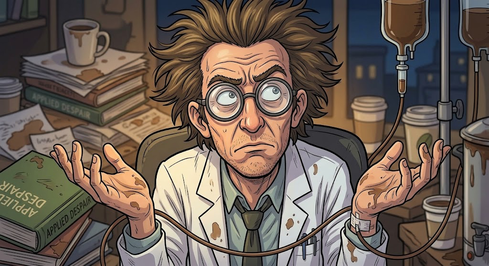
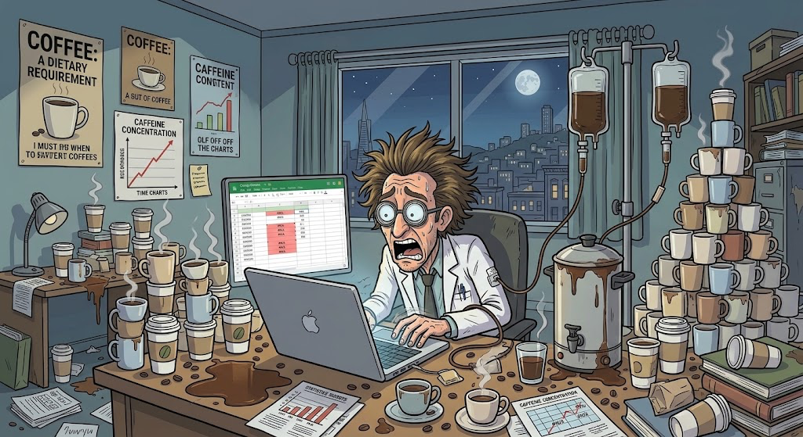
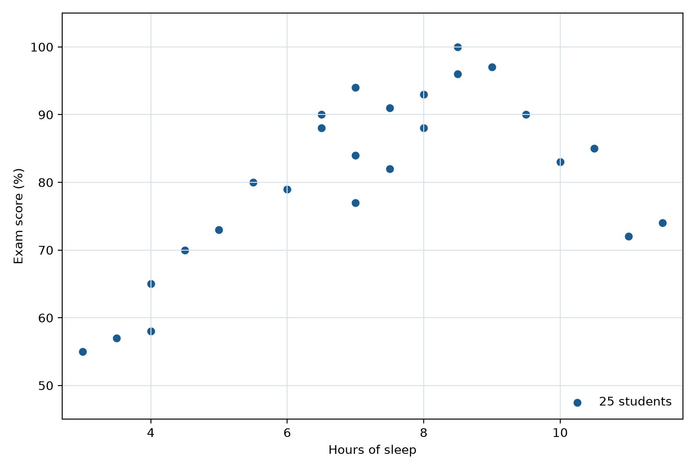
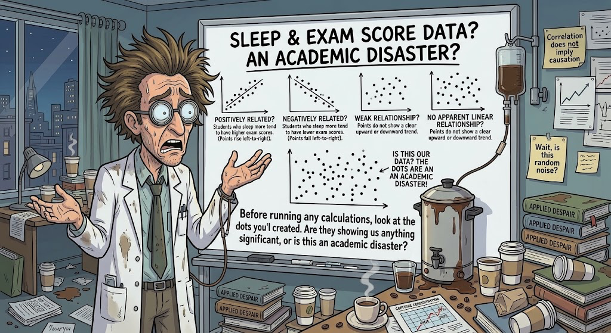
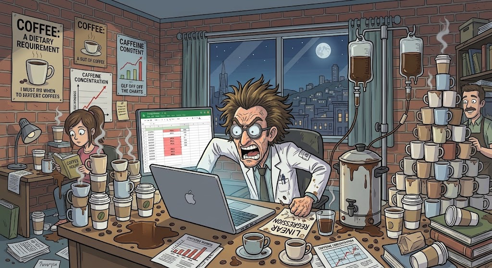

# Dr. Caffeine's All-Nighter Academy: linear regression

This is tutorial 2 of 3. Familiarity with spreadsheet entry and descriptive statistics is helpful. The supplied workbook repeats all 25 observations, so no completed previous workbook is required.

`Dr_Caffeines_All_Nighter_Academy_Student_Workbook.xlsx`

**Does Sleep Affect Exam Scores?**

*Linear regression is a statistical method that models the relationship between two quantitative variables by fitting a straight line to the data. It can help us describe the direction and strength of a linear relationship and evaluate whether the data provides evidence of an association between the variables.*

## Workbook

### Sheet: Data

| Hours of Sleep | Exam score (%) |
| --- | --- |
| 3 | 55 |
| 3.5 | 57 |
| 4 | 58 |
| 4 | 65 |
| 4.5 | 70 |
| 11 | 72 |
| 5 | 73 |
| 11.5 | 74 |
| 7 | 77 |
| 6 | 79 |
| 5.5 | 80 |
| 7.5 | 82 |
| 10 | 83 |
| 7 | 84 |
| 10.5 | 85 |
| 6.5 | 88 |
| 8 | 88 |
| 6.5 | 90 |
| 9.5 | 90 |
| 7.5 | 91 |
| 8 | 93 |
| 7 | 94 |
| 8.5 | 96 |
| 9 | 97 |
| 8.5 | 100 |

- **Region A1:B101:** source

### Sheet: Sample Mean

| Hours of Sleep | Exam score (%) |
| --- | --- |
| 3 | 55 |
| 3.5 | 57 |
| 4 | 58 |
| 4 | 65 |
| 4.5 | 70 |
| 11 | 72 |
| 5 | 73 |
| 11.5 | 74 |
| 7 | 77 |
| 6 | 79 |
| 5.5 | 80 |
| 7.5 | 82 |
| 10 | 83 |
| 7 | 84 |
| 10.5 | 85 |
| 6.5 | 88 |
| 8 | 88 |
| 6.5 | 90 |
| 9.5 | 90 |
| 7.5 | 91 |
| 8 | 93 |
| 7 | 94 |
| 8.5 | 96 |
| 9 | 97 |
| 8.5 | 100 |

#### At: D1

| Statistic | Hours of sleep | Exam score (%) |
| --- | --- | --- |
| Mean | | |
| Median | | |
| Sample standard deviation | | |

- **Region A1:B101:** source
- **Region D1:F4:** calculation

### Sheet: Linear Regression

| Hours of Sleep | Exam score (%) |
| --- | --- |
| 3 | 55 |
| 3.5 | 57 |
| 4 | 58 |
| 4 | 65 |
| 4.5 | 70 |
| 11 | 72 |
| 5 | 73 |
| 11.5 | 74 |
| 7 | 77 |
| 6 | 79 |
| 5.5 | 80 |
| 7.5 | 82 |
| 10 | 83 |
| 7 | 84 |
| 10.5 | 85 |
| 6.5 | 88 |
| 8 | 88 |
| 6.5 | 90 |
| 9.5 | 90 |
| 7.5 | 91 |
| 8 | 93 |
| 7 | 94 |
| 8.5 | 96 |
| 9 | 97 |
| 8.5 | 100 |

#### At: D1

| Regression measure | Calculated result |
| --- | --- |
| Slope | |
| | |
| | |
| | |
| Intercept | |
| | |
| | |
| | |
| R-squared | |
| | |
| | |
| | |
| Predicted score at 7 hours | |

#### At: G1

| Regression statistic | Value |
| --- | --- |
| Slope | |
| Standard error of slope | |
| | |
| Residual degrees of freedom | |

#### At: J1

| Slope significance test | Value |
| --- | --- |
| t-statistic | |
| | |
| | |
| | |
| Residual degrees of freedom | |
| | |
| | |
| | |
| Two-tailed p-value | |

- **Region A1:B101:** source
- **Region D1:E14:** calculation
- **Region G1:H5:** results
- **Region J1:K10:** results

### Sheet: Quadratic Regression

| Hours of Sleep | Exam score (%) |
| --- | --- |
| 3 | 55 |
| 3.5 | 57 |
| 4 | 58 |
| 4 | 65 |
| 4.5 | 70 |
| 11 | 72 |
| 5 | 73 |
| 11.5 | 74 |
| 7 | 77 |
| 6 | 79 |
| 5.5 | 80 |
| 7.5 | 82 |
| 10 | 83 |
| 7 | 84 |
| 10.5 | 85 |
| 6.5 | 88 |
| 8 | 88 |
| 6.5 | 90 |
| 9.5 | 90 |
| 7.5 | 91 |
| 8 | 93 |
| 7 | 94 |
| 8.5 | 96 |
| 9 | 97 |
| 8.5 | 100 |

#### At: C1

| Sleep hours squared |
| --- |
| |

#### At: E1

| Sleep hours | Sleep hours squared |
| --- | --- |
| | |

#### At: H1

| Quadratic statistic | Value |
| --- | --- |
| Quadratic coefficient a | |
| Linear coefficient b | |
| Intercept c | |
| Quadratic R-squared | |
| Standard error of a | |
| Residual degrees of freedom | |
| Predicted score at 7 hours | |
| | |
| t-statistic for quadratic term | |
| Two-tailed p-value | |

#### At: H13

| Model equation | y = ax^2 + bx + c |
| --- | --- |
| At 7 hours of sleep | `a*7^2 + b*7 + c` |

#### At: M1

| Linear comparison | Value |
| --- | --- |
| Slope | |
| Intercept | |
| Linear R-squared | |

- **Region A1:B101:** source
- **Region C1:C101:** calculation
- **Region E1:F101:** calculation
- **Region H1:I11:** results
- **Region M1:N4:** results

### Reflection Questions

1. Predict the scatterplot pattern before calculating.
2. Interpret the slope with units and state whether it proves causation.
3. Interpret the intercept. Is 0 hours of sleep within the observed range?
4. State the prediction for 7 hours of sleep and why it is not a guarantee.
5. Interpret R-squared for the linear model.
6. State the p-value, decision at alpha = 0.05, and conclusion about a linear slope.
7. Does a straight line capture the overall pattern? Explain.

## Tutorial

### Part 2: **Scenario:**

- **Worksheet:** Linear Regression

Welcome to the **All-Nighter Academy**, where the coffee is strong, the students are exhausted, and the final exams are approaching!

Dr. Caffeine has noticed that some students stay up late studying while others prioritize getting a full night's sleep. He suspects that the amount of sleep students get may be related to their final exam scores.

But is there ***actually*** a relationship between sleep and exam performance, or is Dr. Caffeine just running on too much caffeine? In this tutorial, you will use Google Sheets to explore the relationship between students' hours of sleep and their final exam scores. We'll start by using linear regression to fit a straight line to the data. But what happens when students who get *too much* sleep start scoring lower on their exams? A straight line might not tell the whole story! We'll then explore quadratic regression to see if a curved model might better describe the relationship. Grab your coffee, let's get into it.

#### Research question

*Does the number of hours of sleep a student gets predict their final exam score?*

#### Hypotheses: What are we actually testing?

**null hypothesis, H0:** There is no linear relationship between hours of sleep and final exam scores in the population. (the regression slope is zero)

**alternative hypothesis, Ha:** There is a linear relationship between hours of sleep and final exam scores in the population. (the regression slope is not zero)

Basically, we're testing whether there is evidence of a straight-line relationship between sleep and exam scores. Dr. Caffeine wants answers, and we have statistics!

#### Step: **Set Up Your Google Sheet**

1. Open **Dr_Caffeines_All_Nighter_Academy_Student_Workbook.xlsx** in Google Sheets, containing the template data created by your favorite grad students.
2. Make a personal copy under **File > Make a copy**.
3. Name your copy `Dr. Caffeine - Your Name - Date`.
4. Use the **Linear Regression** tab throughout; A1:B26 contains all 25 paired observations. Keep each student's pair together. Enter each formula in its named cell, including the opening =, then press Enter. Record written responses in the reflection tab.

#### Step: **Identify Variables**

**Before performing any calculations, we need to identify the two variables in the study.**

For this part, use the data in the Google Sheets **Linear Regression** tab.

1. **X (predictor):** hours of sleep a student gets\
   * Column **A** of **Linear Regression** tab\
2. **Y (response):** the student's final exam score\
   * Column **B** of **Linear Regression** tab

In this scenario, sleep is the predictor variable, and exam score is the response variable. We are investigating whether students' sleep duration can help predict their exam scores. *This does not automatically mean that sleep causes a change in exam performance.* Other factors, such as studying habits, stress, and maybe lack of or too much caffeine intake, may also affect scores.

#### Step: **Make a scatter plot**

Before calculating a regression equation, it's important to visualize the data. A scatterplot allows us to view the direction, form, and strength of the relationship between sleep hours and exam scores. Basically, each student becomes a dot; statistically useful.\
\

##### Substep: **Create the chart**

1. Find the 'Hours of Sleep' and 'Exam Score (%)' columns already supplied in the 'Linear Regression' tab\
2. [Highlight the columns containing hours of sleep (**A**) and final exam scores (**B**), including the column headings](select:A1:B101)\
3. Select **Insert -> Chart**\
4. In the Chart editor, choose **Scatter chart** as the chart type.\
5. Make sure hours of sleep are on the x-axis and exam scores are on the y-axis\
6. Add an informative chart title, such as *Hours of Sleep vs. Final Exam Scores*\
7. Label the axes:\
   * Horizontal axis: Hours of Sleep\
   * Vertical axis: Final Exam Score (%)

##### Substep: **Examine the relationship: What is our Scatterplot even Telling us?**

Before running any calculations, look at the dots you have created. Are they showing us anything significant, *or is this an academic disaster?*

* **Positive relationship:** students who sleep more tend to have higher exam scores. The points generally rise from left to right.\
* **Negative relationship:** students who sleep more tend to have lower exam scores. The points generally fall from left to right\
* **Weak relationship:** the points show a general upward or downward trend, but they are widely scattered instead of closely following a straight line\
* **No apparent linear relationship:** the points do not show a clear upward or downward trend. However, they may still show a pattern, like a curve

**Pause and predict.**

**Reflection 2.1:** Predict the scatterplot pattern before calculating. Write your answer in the Part 2 Reflection tab.

Don't worry about getting it right just yet; we're about to put this data to work.

#### Step: **Calculate linear regression**

Now that you have visualized the data, you can use linear regression to describe the relationship mathematically.

##### Substep: Understand the regression equation

**Simple Linear Regression:** Finds the straight line that best represents the overall pattern of the dots (each student is a dot on a scatterplot).

**A simple linear regression equation is:**\
**Predicted exam score =** intercept + slope x hours of sleep\

In familiar algebra, the predicted exam score follows:

$y = mx + b$

Here, $y$ is the predicted exam score, $x$ is hours of sleep, $m$ is the slope, and $b$ is the intercept. The workbook uses the equivalent regression notation:

$\hat{y} = b_0 + b_1x$

For workbook results, $b_1 = m$ and $b_0 = b$.

**Here's the familiar algebra translation:**

$y$ = predicted exam score\
$m$ = slope: predicted change in score for each additional hour of sleep\
$b$ = intercept: predicted score at 0 hours of sleep\
$x$ = hours of sleep

##### Substep: Calculate the slope

The supplied table already names the **Regression measure** and **Calculated result** columns.

1. In the supplied **Slope** row, use cell **E2** to calculate the sample slope with SLOPE:\
   * Enter: [=SLOPE(FILTER(B2:B101,ISNUMBER(A2:A101)*ISNUMBER(B2:B101)),FILTER(A2:A101,ISNUMBER(A2:A101)*ISNUMBER(B2:B101)))](enter:E2)\
   * This formula calculates the slope of the best-fitting straight line through the data. In other words, it tells us how much the predicted exam score changes for every additional hour of sleep.\
##### Substep: Calculate the intercept

1. In the supplied **Intercept** row, use cell **E6** to calculate the intercept of the regression line with INTERCEPT:\
   * Enter: [=INTERCEPT(FILTER(B2:B101,ISNUMBER(A2:A101)*ISNUMBER(B2:B101)),FILTER(A2:A101,ISNUMBER(A2:A101)*ISNUMBER(B2:B101)))](enter:E6)\
##### Substep: Calculate R2

1. In the supplied **R-squared** row, use cell **E10** to calculate the sample's R2 with RSQ:\
   * Enter: [=RSQ(FILTER(B2:B101,ISNUMBER(A2:A101)*ISNUMBER(B2:B101)),FILTER(A2:A101,ISNUMBER(A2:A101)*ISNUMBER(B2:B101)))](enter:E10)\
   * This formula calculates the coefficient of determination, R2, which describes the proportion of variation in exam scores explained by hours of sleep.\
##### Substep: Display the regression equation on the chart

1. Select the scatterplot.
2. Open the Chart Editor and select **Customize -> Series**.
3. Turn on the Trendline and select Linear.
4. Under the trendline options, select **Use Equation.**
5. Optionally, display R2 on the chart if this is available on your screen! Make sure the equation plus the R2 displayed on your chart actually corresponds to the same data used in your calculations!

#### Step: **Interpret the linear regression**

##### Substep: **Okay, now we have our equation, but what does it actually mean?**

Let's use a hypothetical example:

**Predicted exam score = 45 + (5 x hours of sleep)**

**Intercept (45):** The model predicts an exam score of 45% for a student who gets 0 hours of sleep. This may not be practically meaningful.

**Slope (5):** For each additional hour of sleep, the predicted exam score increases by 5 percentage points, on average.

These values are hypothetical examples! Use actual values from your own spreadsheet when you are interpreting your results, and also remember that the slope describes an association and does not prove that the additional sleep causes higher exam scores.

##### Substep: **Interpret the calculated slope and intercept**

Use your calculated slope and intercept for these two reflections.

**Reflection 2.2:** Interpret the slope with units and state whether it proves causation. Write your answer in the Part 2 Reflection tab.

**Reflection 2.3:** Interpret the intercept. Is 0 hours of sleep within the observed range? Write your answer in the Part 2 Reflection tab.

1. **Slope (E2):** As hours of sleep increase by one hour, the predicted final score changes by approximately [insert your slope] points, on average.
   - A positive slope indicates an upward linear trend, while a negative slope indicates a downward linear trend. Compare the trend with your prediction from reflection question 1.
2. **Intercept (E6):** The intercept represents the predicted exam score when a student gets zero hours of sleep.
   - Note: *although the intercept is necessary to define the regression line, this prediction may not be practically meaningful if '0 hours' falls outside the range of sleep durations in our dataset.*

##### Substep: Predict a score at seven hours

1. Use the familiar linear equation $y = mx + b$ to predict the score for a student who gets 7 hours of sleep; here $y$ is the predicted exam score.
2. Substitute $x = 7$: $y = m(7) + b$. In the workbook, use $m = b_1$ and $b = b_0$.
3. Use your own slope and intercept to calculate the predicted score. In the supplied **Predicted score at 7 hours** row, enter [=E6+E2*7](enter:E14) in E14. Remember that this is a model-based prediction, not a guarantee of what a student would actually score.
**Reflection 2.4:** State the prediction for 7 hours of sleep and why it is not a guarantee. Write your answer in the Part 2 Reflection tab.

#### Step: **Evaluate regression**

A regression equation can describe a pattern, but we also need to see how well it fits the data, and if there's statistical evidence of a linear relationship.

##### Substep: **Interpret R2**

1. R2 describes the proportion of variation in the exam scores that is accounted for by the linear regression model using hours of sleep.\
2. For example, if R2 = 0.60, then 60% of the variation in the exam scores is accounted for by the fitted linear regression model. However, R2 alone does not tell us whether a straight line is the best way to describe the relationship.\
**Reflection 2.5:** Interpret R-squared for the linear model. Write your answer in the Part 2 Reflection tab.

##### Substep: **To determine whether there is actual statistical evidence of a linear relationship, we need to test the regression slope!**

In plain language, we test whether the population relationship has a nonzero slope. Using $m$ for the population slope, the hypotheses are:

* **null hypothesis, H0: $m$ = 0** -- There is no linear relationship between sleep hours and exam scores in the population.\
* **alternative hypothesis, Ha: $m$ &ne; 0** -- There is a linear relationship between sleep hours and exam scores in the population.

##### Substep: **Calculate the regression statistics in Google Sheets**

One way to obtain the necessary regression statistics is to use LINEST. The output contains the slope and intercept, their standard errors, and additional regression statistics. INDEX extracts individual values so no array spills into neighboring cells.

1. The supplied **Regression statistic** table identifies each result row.
2. In its supplied **Slope** row,\
   enter [=INDEX(LINEST(FILTER(B2:B101,ISNUMBER(A2:A101)*ISNUMBER(B2:B101)),FILTER(A2:A101,ISNUMBER(A2:A101)*ISNUMBER(B2:B101)),TRUE,TRUE),1,1)](enter:H2) in H2.
3. In its supplied **Standard error of slope** row,\
   enter [=INDEX(LINEST(FILTER(B2:B101,ISNUMBER(A2:A101)*ISNUMBER(B2:B101)),FILTER(A2:A101,ISNUMBER(A2:A101)*ISNUMBER(B2:B101)),TRUE,TRUE),2,1)](enter:H3) in H3.
4. In its supplied **Residual degrees of freedom** row,\
   enter [=INDEX(LINEST(FILTER(B2:B101,ISNUMBER(A2:A101)*ISNUMBER(B2:B101)),FILTER(A2:A101,ISNUMBER(A2:A101)*ISNUMBER(B2:B101)),TRUE,TRUE),4,2)](enter:H5) in H5. The slope should agree with E2, and the degrees of freedom should be 25 - 2 = 23.

##### Substep: **Calculate the t-statistic**

The t-statistic measures how many standard errors the slope is from zero

t = slope / standard error of slope

1. In the supplied **t-statistic** row, select cell **K2** and enter: [=H2/H3](enter:K2)

##### Substep: **Calculate the p-value**

In this step we will calculate the two-tailed p-value to test whether the slope differs from zero in either direction.\
Note: We would calculate a one-tailed p-value instead if we a had a specific directional hypothesis, for example if more sleep was associated with [higher|lower] exam scores, and we only wanted to test for evidence in that direction.

1. In the supplied **Residual degrees of freedom** row, select cell **K6** and enter: [=H5](enter:K6)\
2. In the supplied **Two-tailed p-value** row, select cell **K10** and enter: [=T.DIST.2T(ABS(K2),K6)](enter:K10)

##### Substep: **Finally, let's make a decision! Is Dr. Caffeine onto something?**

Okay, time to see if all that coffee-fueled studying is actually paying off! We're going to use our p-value to decide whether there's enough evidence to support a linear relationship between hours of sleep and exam scores.

Record the **two-tailed p-value for a slope differing from zero in either direction = _____**. Classical slope inference assumes an appropriate linear mean model with independent, normally distributed errors of constant variance; a p-value alone cannot check those assumptions.

Compare the p-value in **K10** with the significance level of **&alpha; = 0.05**!

* **If p < 0.05:** Reject the null hypothesis! We have statistically significant evidence of a linear relationship between hours of sleep and exam scores. Dr. Caffeine might be onto something!\
* **If p &ge; 0.05:** Fail to reject the null hypothesis. We don't have enough evidence to conclude that a linear relationship exists. Sorry, Dr. Caffeine, we can't blame the all-nighters just yet!\
**Reflection 2.6:** State the p-value, decision at alpha = 0.05, and conclusion about a linear slope. Write your answer in the Part 2 Reflection tab.

*A p-value doesn't tell us how strong the relationship is, and it doesn't tell us the probability that the null hypothesis is true. It just helps us decide whether our data provide enough evidence against the null hypothesis. Statistics: humbling us one coffee at a time.*

#### Step: **Interpret results**

We've made our chart, calculated our regression equation AND tested our hypothesis. Now it's time to take a step back and look at the bigger picture!

**Reflection 2.7:** Does a straight line capture the overall pattern? Explain. Write your answer in the Part 2 Reflection tab.

Your slope should be about 3.18 percentage points per hour and R-squared about 0.347. A significant positive slope can coexist with curvature that a straight line misses. Include your labeled scatterplot, regression calculations, seven-hour prediction, two-tailed slope-test decision, and reflection notes for submission. Continue to the quadratic regression tutorial to investigate the curve.
