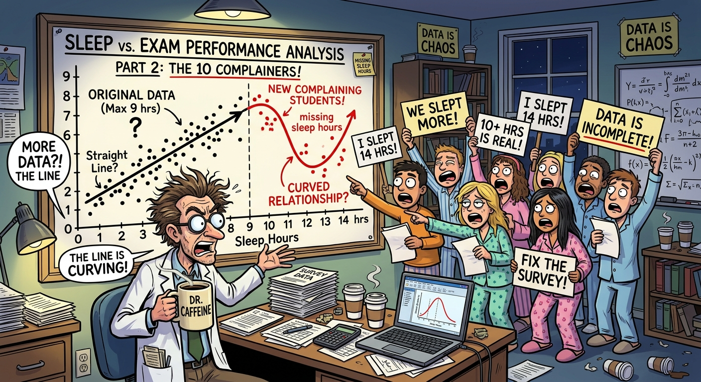
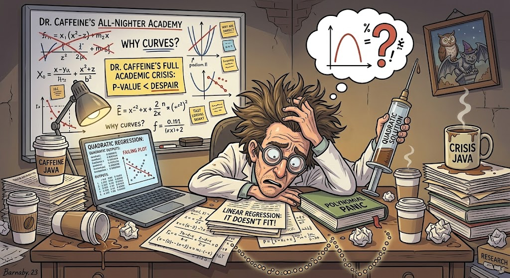
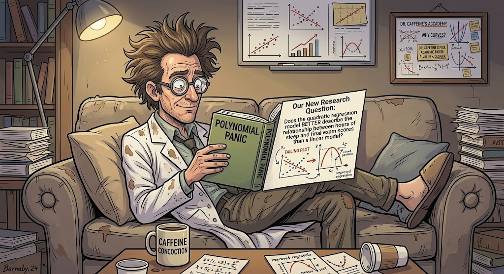
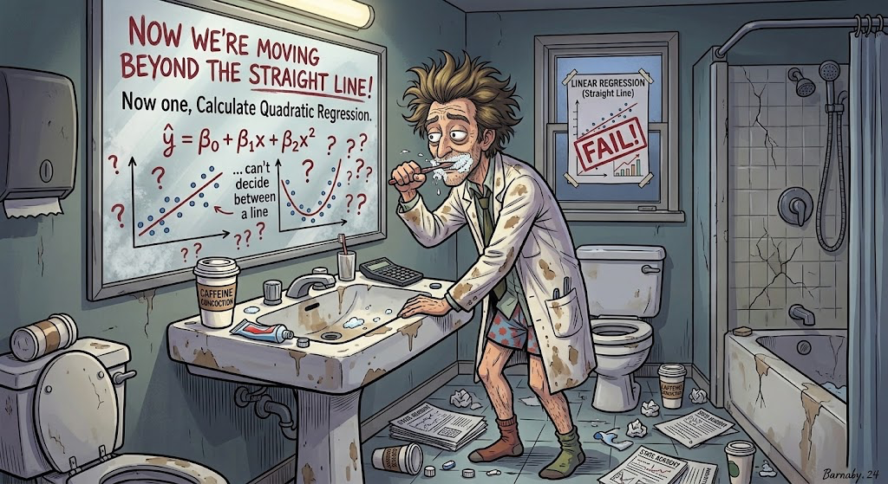
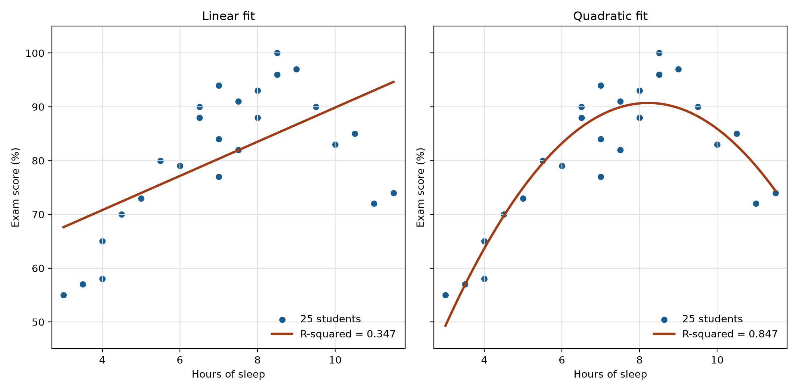
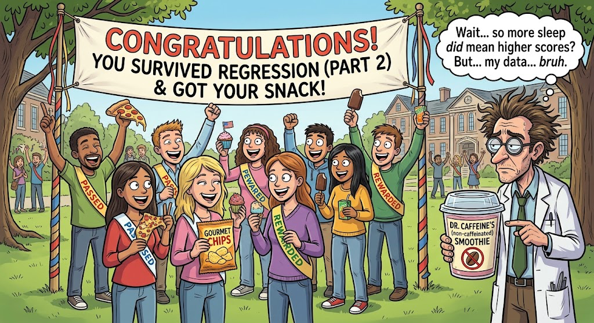

# Dr. Caffeine's All-Nighter Academy: quadratic regression

This is tutorial 3 of 3. Complete the linear regression tutorial first or bring equivalent knowledge of scatterplots, slope, intercept, R-squared, and two-tailed regression tests. The supplied workbook repeats all 25 observations and recreates the linear comparison, so no previous workbook is required.

`Dr_Caffeines_All_Nighter_Academy_Student_Workbook.xlsx`

## Workbook

### Sheet: Data

| Hours of Sleep | Exam score (%) |
| --- | --- |
| 3 | 55 |
| 3.5 | 57 |
| 4 | 58 |
| 4 | 65 |
| 4.5 | 70 |
| 11 | 72 |
| 5 | 73 |
| 11.5 | 74 |
| 7 | 77 |
| 6 | 79 |
| 5.5 | 80 |
| 7.5 | 82 |
| 10 | 83 |
| 7 | 84 |
| 10.5 | 85 |
| 6.5 | 88 |
| 8 | 88 |
| 6.5 | 90 |
| 9.5 | 90 |
| 7.5 | 91 |
| 8 | 93 |
| 7 | 94 |
| 8.5 | 96 |
| 9 | 97 |
| 8.5 | 100 |

- **Region A1:B101:** source

### Sheet: Sample Mean

| Hours of Sleep | Exam score (%) |
| --- | --- |
| 3 | 55 |
| 3.5 | 57 |
| 4 | 58 |
| 4 | 65 |
| 4.5 | 70 |
| 11 | 72 |
| 5 | 73 |
| 11.5 | 74 |
| 7 | 77 |
| 6 | 79 |
| 5.5 | 80 |
| 7.5 | 82 |
| 10 | 83 |
| 7 | 84 |
| 10.5 | 85 |
| 6.5 | 88 |
| 8 | 88 |
| 6.5 | 90 |
| 9.5 | 90 |
| 7.5 | 91 |
| 8 | 93 |
| 7 | 94 |
| 8.5 | 96 |
| 9 | 97 |
| 8.5 | 100 |

#### At: D1

| Statistic | Hours of sleep | Exam score (%) |
| --- | --- | --- |
| Mean | | |
| Median | | |
| Sample standard deviation | | |

- **Region A1:B101:** source
- **Region D1:F4:** calculation

### Sheet: Linear Regression

| Hours of Sleep | Exam score (%) |
| --- | --- |
| 3 | 55 |
| 3.5 | 57 |
| 4 | 58 |
| 4 | 65 |
| 4.5 | 70 |
| 11 | 72 |
| 5 | 73 |
| 11.5 | 74 |
| 7 | 77 |
| 6 | 79 |
| 5.5 | 80 |
| 7.5 | 82 |
| 10 | 83 |
| 7 | 84 |
| 10.5 | 85 |
| 6.5 | 88 |
| 8 | 88 |
| 6.5 | 90 |
| 9.5 | 90 |
| 7.5 | 91 |
| 8 | 93 |
| 7 | 94 |
| 8.5 | 96 |
| 9 | 97 |
| 8.5 | 100 |

#### At: D1

| Regression measure | Calculated result |
| --- | --- |
| Slope | |
| | |
| | |
| | |
| Intercept | |
| | |
| | |
| | |
| R-squared | |
| | |
| | |
| | |
| Predicted score at 7 hours | |

#### At: G1

| Regression statistic | Value |
| --- | --- |
| Slope | |
| Standard error of slope | |
| | |
| Residual degrees of freedom | |

#### At: J1

| Slope significance test | Value |
| --- | --- |
| t-statistic | |
| | |
| | |
| | |
| Residual degrees of freedom | |
| | |
| | |
| | |
| Two-tailed p-value | |

- **Region A1:B101:** source
- **Region D1:E14:** calculation
- **Region G1:H5:** results
- **Region J1:K10:** results

### Sheet: Quadratic Regression

| Hours of Sleep | Exam score (%) |
| --- | --- |
| 3 | 55 |
| 3.5 | 57 |
| 4 | 58 |
| 4 | 65 |
| 4.5 | 70 |
| 11 | 72 |
| 5 | 73 |
| 11.5 | 74 |
| 7 | 77 |
| 6 | 79 |
| 5.5 | 80 |
| 7.5 | 82 |
| 10 | 83 |
| 7 | 84 |
| 10.5 | 85 |
| 6.5 | 88 |
| 8 | 88 |
| 6.5 | 90 |
| 9.5 | 90 |
| 7.5 | 91 |
| 8 | 93 |
| 7 | 94 |
| 8.5 | 96 |
| 9 | 97 |
| 8.5 | 100 |

#### At: C1

| Sleep hours squared |
| --- |
| |

#### At: E1

| Sleep hours | Sleep hours squared |
| --- | --- |
| | |

#### At: H1

| Quadratic statistic | Value |
| --- | --- |
| Quadratic coefficient a | |
| Linear coefficient b | |
| Intercept c | |
| Quadratic R-squared | |
| Standard error of a | |
| Residual degrees of freedom | |
| Predicted score at 7 hours | |
| | |
| t-statistic for quadratic term | |
| Two-tailed p-value | |

#### At: H13

| Model equation | y = ax^2 + bx + c |
| --- | --- |
| At 7 hours of sleep | `a*7^2 + b*7 + c` |

#### At: M1

| Linear comparison | Value |
| --- | --- |
| Slope | |
| Intercept | |
| Linear R-squared | |

- **Region A1:B101:** source
- **Region C1:C101:** calculation
- **Region E1:F101:** calculation
- **Region H1:I11:** results
- **Region M1:N4:** results

### Reflection Questions

1. What pattern does the scatterplot show that a straight line misses?
2. What does the sign of the quadratic coefficient a say about the curve?
3. State the quadratic R-squared and compare it with the linear R-squared.
4. State the quadratic-term p-value and your decision at alpha = 0.05.
5. Why is this p-value exploratory after choosing the curve from the same data?
6. Explain why the analysis does not prove that sleep causes exam performance.
7. Why would a prediction at 16 hours be extrapolation?

## Tutorial

### Part 3: **Why Straight Lines Fail, The Plot Twist! - QUADRATIC Regression!**

- **Worksheet:** Quadratic Regression

Now that we've officially run our linear regression, Dr. Caffeine is staring at the results like he just failed his own exam. The line exists, sure, and its positive slope is statistically significant, but it misses the curve in these data. Looking at our scatterplot, the points form an upside-down U, almost like students' brains function perfectly until they sleep near the low or high end of the observed 3-to-11.5-hour range. Apparently, there IS a curve in this dataset! Students in this dataset who get a moderate amount of sleep tend to score the highest, while those near either end of the observed range tend to score lower. Unfortunately, a straight line cannot capture this academic roller coaster. Dr. Caffeine needs a new plan, another cup of coffee, and possibly a nap himself?

#### Step: Set Up Your Google Sheet

##### Substep: Open the workbook

1. Open the supplied workbook, or continue with your copy from Parts 1 and 2. Open **Quadratic Regression**, where A1:B26 contains all 25 paired observations, and record written responses in the reflection tab. A fresh workbook works for this Part; you do not need completed Part 2 cells.

##### Substep: Create the comparison scatterplot

1. [Select A1:B101](select:A1:B101).
2. Choose **Insert -> Chart**.
3. Choose **Scatter chart**.
4. Label the x-axis Hours of Sleep and the y-axis Final Exam Score (%), and add an informative title.

##### Substep: Bring forward the linear results

The linear comparison labels are already present. If you completed Part 2 in this workbook, copy its results into this sheet. If you are starting with a fresh workbook, use the three formulas below instead.

1. Copy E2 (slope) from **Linear Regression** and paste into N2 on **Quadratic Regression** using **Edit > Paste special > Values only**.
2. Copy E6 (intercept) from **Linear Regression** and paste values only into N3 on **Quadratic Regression**.
3. Copy E10 (linear R-squared) from **Linear Regression** and paste values only into N4 on **Quadratic Regression**.

Copy the cell values rather than retyping rounded numbers from the screen. Values-only pasting keeps the calculated numbers without copying formulas whose cell references could change.

**Starting with a fresh workbook? Calculate the linear results here instead.** These formulas use the observations already on **Quadratic Regression**. They work even when the **Linear Regression** tab has no completed answers. Use these instead of the copying instructions above.

1. In N2, calculate the linear slope:
   [=SLOPE(FILTER(B2:B101,ISNUMBER(A2:A101)*ISNUMBER(B2:B101)),FILTER(A2:A101,ISNUMBER(A2:A101)*ISNUMBER(B2:B101)))](enter:N2)
2. In N3, calculate the linear intercept:
   [=INTERCEPT(FILTER(B2:B101,ISNUMBER(A2:A101)*ISNUMBER(B2:B101)),FILTER(A2:A101,ISNUMBER(A2:A101)*ISNUMBER(B2:B101)))](enter:N3)
3. In N4, calculate the linear R-squared:
   [=RSQ(FILTER(B2:B101,ISNUMBER(A2:A101)*ISNUMBER(B2:B101)),FILTER(A2:A101,ISNUMBER(A2:A101)*ISNUMBER(B2:B101)))](enter:N4)

**Let's see why our linear regression is not giving what it needs to give.**

#### Step: **Straight Linear Regression**

##### Substep: Add the linear trendline

1. **Add the Linear Trendline First:** On your scatterplot, open the Chart Editor and select **Customize -> Series**. Turn on the **Trendline** and select **Linear**. Make sure to display the equation and (R^2) value. We need receipts because Dr. Caffeine is NOT about to trust a line just because it looks official.\

##### Substep: Observe the disconnect

1. **Observe the Disconnect:** Look at that straight line running through the middle of the scatterplot. Like... respectfully, what is going on here? Our data is forming a whole upside-down U, and this line is acting like everything is perfectly linear. Students who get a moderate amount of sleep tend to score higher, while those who barely sleep or sleep like they're in a three-day coma tend to score lower. The pattern is an academic roller coaster.\

##### Substep: Check the linear comparison

1. **Check your linear receipts:** Use the linear $R^2$ value in N4; if you completed the previous tutorial, it should agree with that result. Dr. Caffeine has his coffee, we have our calculations, and yet this line is still not connecting the dots. $R^2$ describes the variation accounted for by the linear fit; its value alone cannot show whether a straight line captures this pattern. At this point, we need to regroup.

**Reflection 3.1:** What pattern does the scatterplot show that a straight line misses? Write your answer in the Part 3 Reflection tab.

**Time for QUADRATIC REGRESSION!** Since exam scores appear to peak at a moderate amount of sleep and decrease when students get either too little or too much, a curved model may better represent the relationship. Because apparently, sleep has a sweet spot, and statistics refuse to let us have a simple answer. Let's see if quadratic regression can save this project before Dr. Caffeine has a full academic crisis!

#### Step: Frame the quadratic analysis

##### Substep: Research question

Does the quadratic regression model better describe the relationship between hours of sleep and final exam scores than a linear model?

##### Substep: Hypotheses for the quadratic term

In plain language, we ask whether the relationship needs a curve instead of a straight line. We test whether the population value of the quadratic coefficient $a$ differs from zero. If $a = 0$, the squared term drops out and the model is a straight line.

* **null hypothesis, H0: $a$ = 0** -- There is no quadratic term in the population model.\
* **alternative hypothesis, Ha: $a$ &ne; 0** -- There is evidence of a quadratic term in the population model

**Basically, we're asking whether the relationship needs a curve instead of a straight line.**

#### Step: **Create a SQUARED Sleep-Hours Column**

To let our regression model curve, we need to square our predictor variable (x).

##### Substep: Construct the squared predictor

1. Use blank column C in your spreadsheet.\
2. Column C already has the supplied header **Sleep Hours Squared (x^2)**.\
3. In C2, enter:
   [=IF(ISNUMBER(A2),A2^2,"")](enter:C2)
4. Press Enter, then [drag the little blue square all the way down to the bottom](fill:C2:C101) to make sure it applies to all students! Basically, we're taking each student's hours of sleep and multiplying that number by itself. If someone slept 6 hours, their squared sleep value is 36! Don't worry, they didn't sleep for 36 hours!

#### Step: **Calculate Quadratic Regression**

##### Substep: Understand the quadratic model

Now we are moving beyond the straight line!\
**Quadratic Regression:** a type of polynomial regression that is curved with respect to x.\

Our familiar equation for predicted exam score is:

$y = ax^2 + bx + c$

The square stays with $x$: it is what allows the model to curve. The workbook uses the same $a$, $b$, and $c$ labels.

For later statistics courses: you may see the population model written as $y = \beta_0 + \beta_1x + \beta_2x^2 + \varepsilon$, where $\varepsilon$ represents unexplained variation. Its fitted prediction uses $c$, $b$, and $a$ in those respective positions. You do not need beta notation for this tutorial.

**Here's the breakdown:**\
$y$ = predicted exam score\
$a$ = quadratic coefficient\
$b$ = linear coefficient\
$c$ = intercept\
$x$ = hours of sleep

*That extra x^2 term is what gives the model its curve.  Now that we know what all these symbols mean, let's get into Google Sheets and see whether or not your data actually is giving us a curve.*

This remains linear regression in its coefficients; the squared predictor lets the relationship curve with respect to sleep hours.

##### Substep: Construct the aligned predictor columns

Use the supplied adjacent predictor headers **Sleep Hours** (E1) and **Sleep Hours Squared** (F1).

1. In E2, enter:
   [=IF(ISNUMBER(A2),A2,"")](enter:E2)
2. In F2, enter:
   [=IF(ISNUMBER(A2),C2,"")](enter:F2)
3. [Fill both predictor columns down to row 101](fill:E2:F101).
4. Keep both predictors aligned with the same student in column B; E26 should show 8.5 and F26 should show 72.25.

#### Step: **Run Quadratic Regression in Google Sheets**

##### Substep: Calculate the model coefficients

We can use LINEST to fit the quadratic model by including both sleep hours and squared sleep hours as predictors. To avoid accidentally including exam scores as a predictor, use the separate adjacent predictor table in E2:F26 and the response range B2:B26. INDEX extracts scalar results without an array spilling into neighboring cells.

This tells Google Sheets to predict exam scores using both sleep hours and sleep hours squared! The first term captures the linear part of the relationship, while the squared term lets the model CURVE!

An important note, the output from LINEST can be a little confusing sometimes because it lists the coefficients in reverse order of the predictor columns. For our model:

* The first coefficient is for sleep hours squared\
* The second coefficient is for sleep hours\
* The last value in the first row is the intercept.

Once we have the coefficients, we can plug them into our quadratic equation and see what the model predicts for exam scores at different amounts of sleep.

The supplied **Quadratic statistic** and **Value** headers identify the result table. Calculate:

1. In the supplied **Quadratic coefficient a** row,\
   in I2, enter:
   [=INDEX(LINEST(FILTER(B2:B101,ISNUMBER(A2:A101)*ISNUMBER(B2:B101)),FILTER(E2:F101,ISNUMBER(A2:A101)*ISNUMBER(B2:B101)),TRUE,TRUE),1,1)](enter:I2)
2. In the supplied **Linear coefficient b** row,\
   in I3, enter:
   [=INDEX(LINEST(FILTER(B2:B101,ISNUMBER(A2:A101)*ISNUMBER(B2:B101)),FILTER(E2:F101,ISNUMBER(A2:A101)*ISNUMBER(B2:B101)),TRUE,TRUE),1,2)](enter:I3)
3. In the supplied **Intercept c** row,\
   in I4, enter:
   [=INDEX(LINEST(FILTER(B2:B101,ISNUMBER(A2:A101)*ISNUMBER(B2:B101)),FILTER(E2:F101,ISNUMBER(A2:A101)*ISNUMBER(B2:B101)),TRUE,TRUE),1,3)](enter:I4)
4. In the supplied **Quadratic R-squared** row,\
   in I5, enter:
   [=INDEX(LINEST(FILTER(B2:B101,ISNUMBER(A2:A101)*ISNUMBER(B2:B101)),FILTER(E2:F101,ISNUMBER(A2:A101)*ISNUMBER(B2:B101)),TRUE,TRUE),3,1)](enter:I5)
5. In the supplied **Standard error of a** row,\
   in I6, enter:
   [=INDEX(LINEST(FILTER(B2:B101,ISNUMBER(A2:A101)*ISNUMBER(B2:B101)),FILTER(E2:F101,ISNUMBER(A2:A101)*ISNUMBER(B2:B101)),TRUE,TRUE),2,1)](enter:I6)
6. In the supplied **Residual degrees of freedom** row,\
   in I7, enter:
   [=INDEX(LINEST(FILTER(B2:B101,ISNUMBER(A2:A101)*ISNUMBER(B2:B101)),FILTER(E2:F101,ISNUMBER(A2:A101)*ISNUMBER(B2:B101)),TRUE,TRUE),4,2)](enter:I7)
   The result should be 25 - 3 = 22.
7. Write your fitted equation using I2:I4. Unlike the straight-line slope, $b$ alone is not the score change for every extra hour; the change also depends on sleep through the squared term. The label at H8 is already present. With $a$ in I2, $b$ in I3, and $c$ in I4, substitute 7 for $x$ in $ax^2 + bx + c$. In I8, enter:
   [=I2*7^2+I3*7+I4](enter:I8)
   Compare with the linear prediction N3 + N2 * 7; neither guarantees an individual student's score.

**Reflection 3.2:** What does the sign of the quadratic coefficient a say about the curve? Write your answer in the Part 3 Reflection tab.

##### Substep: Test the quadratic term

For a **two-tailed** test, null hypothesis, H0: $a = 0$ versus alternative hypothesis, Ha: $a \ne 0$ (curvature in either direction), with the linear term retained. Use alpha = 0.05. Inference assumes a suitable quadratic mean model with independent normal errors of constant variance.

1. In the supplied **t-statistic for quadratic term** row, in I10, enter:
   [=I2/I6](enter:I10)
2. Use the labeled two-tailed p-value row at H11. In I11, enter:
   [=T.DIST.2T(ABS(I10),I7)](enter:I11)
   Record the **two-tailed p-value for a nonzero quadratic term in either direction = _____**.
3. If p < 0.05, reject the null hypothesis, H0; otherwise fail to reject it. Interpret this conditionally on the model assumptions.

**Reflection 3.4:** State the quadratic-term p-value and your decision at alpha = 0.05. Write your answer in the Part 3 Reflection tab.

The nominal p-value assumes this model and test were chosen before examining the pattern. Because we selected the curve after seeing these same data, treat the p-value as exploratory: selecting a model after seeing a pattern can make the usual p-value too optimistic. Confirm curvature using new, independent data and a model specified before examining those data.

**Reflection 3.5:** Why is this p-value exploratory after choosing the curve from the same data? Write your answer in the Part 3 Reflection tab.

#### Step: **Compare the Models**

##### Substep: Compare model fit

Okay, here comes the question! Did quadratic regression actually improve our model, or did we just make the equation more complicated for fun? Compare the $R^2$ values from the linear and quadratic models in N4 and I5.

**Reflection 3.3:** State the quadratic R-squared and compare it with the linear R-squared. Write your answer in the Part 3 Reflection tab.

Remember:

* **Linear regression:** Models the relationship using a straight line.\
* **Quadratic regression:** Allows the relationship to curve.

A higher $R^2$ means the model explains a larger proportion of the variation in the exam scores of this dataset. If your quadratic model has a higher $R^2$, that will suggest that the curve fits these data better. HOWEVER! Adding another term will generally make $R^2$ stay the same or even increase, so a higher value alone does not necessarily prove that quadratic regression is the better choice. Look at the actual pattern in the data, too. Does exam performance seem to increase with sleep and then level off? Do you see any curved pattern, or are we just trying to make the data tell us what we want to hear?

##### Substep: Display the quadratic trendline

1. Return to the scatterplot you created on **Quadratic Regression**, open its **Chart Editor -> Customize -> Series -> Trendline**, change **Linear** to **Polynomial**, and set **Degree** to 2. Display the equation and R-squared. Compare the chart against your fitted coefficients, allowing for display rounding.
2. Combine the visual pattern, both R-squared values, and the exploratory quadratic-term test. What supports curvature? What residual checks or new-data performance would you examine before relying on the model?

#### Step: **Our final TAKEAWAY!**

**Congratulations! You survived two regression models, your reward is hopefully a better understanding of statistics and maybe a snack (no coffee.)**

Linear regression helps us describe a straight-line relationship between sleep and exam scores. Quadratic regression gives us the option to model a curved relationship, and comparing the two models helps us figure out whether that extra curve is actually useful.

One thing to remember: a relationship does not automatically mean causation. Even if students who sleep more tend to score higher, this alone cannot prove that sleep caused their scores to improve. Other factors could be involved, including studying, stress, and how much caffeine Dr. Caffeine has been distributing.

**Reflection 3.6:** Explain why the analysis does not prove that sleep causes exam performance. Write your answer in the Part 3 Reflection tab.

With that, class is dismissed! Drink some water, close the 50 browser tabs you have open, and PLEASE get some sleep!

The observed sleep range is 3 to 11.5 hours.

**Reflection 3.7:** Why would a prediction at 16 hours be extrapolation? Write your answer in the Part 3 Reflection tab.

Submit your completed workbook, both fitted equations, and the labeled chart with its quadratic trendline. Explain the association and the limits of your model.
